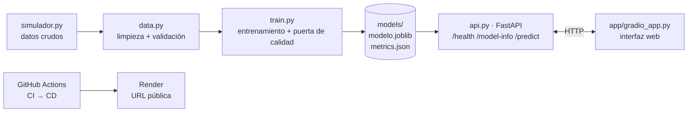

# Mantenimiento predictivo de bombas Warman — MLOps de punta a punta

Proyecto final · Data Science G8 · **Juan Armando Machacca Catari**

## 1. El problema

En el circuito de molienda de una planta concentradora de cobre, **4 bombas centrífugas Warman** alimentan la pulpa a la batería de ciclones. Cuando una falla sin aviso, el molino pierde capacidad de descarga y baja el tratamiento de mineral.

Hoy el mantenimiento de estas bombas es **preventivo por horas** (a veces se posterga por producción) o **correctivo** (cuando ya falló). Un correctivo de impulsor cuesta en promedio **USD 79 mil**, contra **USD 62 mil** del cambio programado, y eso sin contar la producción perdida.

**Qué se predice:** el **estado de una bomba** a partir de una lectura de sus sensores:

| Estado | Qué significa | Acción |
|---|---|---|
| Normal | Operación sana | Monitoreo de rutina |
| Cavitacion | Evento de **proceso** (nivel bajo del cajón), no es falla mecánica | Corregir nivel/dilución; **no** intervenir la bomba |
| Riesgo rodamiento | Rodamiento en deterioro (sube vibración y temperatura) | Programar cambio en los próximos días |
| Riesgo sello | Empaquetadura gastada (sube el consumo de agua de sello) | Cambio de empaquetadura |
| Desgaste impulsor | Impulsor/revestimientos al final de su vida (suben las rpm) | Cambio en la siguiente parada, sin postergar |

**Para quién:** el planner o supervisor de mantenimiento de la planta, que necesita saber **qué bomba intervenir, por qué y con cuánta urgencia**.

## 2. Los datos

El dataset es **propio**. Lo genera un **modelo físico-operativo de las bombas** (`src/warman/simulador.py`), construido a partir de las variables que registran el historiador de planta (PI) y el sistema de mantenimiento (SAP PM). Este modelo reemplaza el acceso a datos históricos de una operación, que son confidenciales.

- 4 bombas, **2 años de lecturas horarias** (70 176 filas) y **51 órdenes de trabajo**.
- Física simplificada pero coherente: la potencia sale de la ecuación hidráulica (ρ·g·Q·H/η), la corriente de la fórmula trifásica, la vida de rodamientos de una distribución Weibull, y el desgaste del impulsor es más rápido con pulpa más densa.
- Incluye problemas reales de instrumentación: valores vacíos, lecturas imposibles (999 °C, −1 mm/s), un **sensor congelado** y episodios de **cavitación** que se parecen a una falla pero no lo son.

La etapa de datos (`data.py`) **limpia** esos problemas y luego **valida en código** columnas, tipos, nulos, rangos físicos y clases. Si algo no cumple, el proceso se detiene.

## 3. Arquitectura



## 4. Resultados

| | |
|---|---|
| Modelo elegido | Random Forest (200 árboles, profundidad máx. 14, clases balanceadas) |
| Línea base | Regresión logística: F1-macro validación 0.891 vs **0.922** del Random Forest |
| **F1-macro en test** | **0.902** (puerta de calidad: ≥ 0.80) |
| Accuracy en test | 0.949 |

| Clase (test jul–dic 2025) | Precisión | Recall | F1 |
|---|---|---|---|
| Normal | 0.98 | 0.96 | 0.97 |
| Cavitacion | 0.94 | 1.00 | 0.97 |
| Riesgo rodamiento | 0.98 | 0.83 | 0.90 |
| Riesgo sello | 0.97 | 0.97 | 0.97 |
| Desgaste impulsor | 0.60 | 0.84 | 0.70 |

El detalle completo, con la matriz de confusión, está en [`models/metrics.json`](models/metrics.json).

### Decisiones clave

- **División temporal, no aleatoria.** Train: ene 2024–mar 2025 · validación: abr–jun 2025 · test: jul–dic 2025. Las lecturas horarias consecutivas son casi iguales; mezclarlas al azar filtraría el futuro al entrenamiento y la métrica saldría inflada.
- **F1-macro como métrica.** El 86 % de las horas son "Normal". Un modelo que siempre dijera "Normal" tendría 86 % de accuracy y sería inútil. F1-macro da el mismo peso a cada estado y obliga a detectar bien las fallas.
- **Puerta de calidad.** Si el F1-macro en test es menor que 0.80 (`config.py`), `entrenar` termina con error, el modelo no se guarda, el CI queda en rojo y la imagen Docker no se construye.
- **Selección justa.** El modelo se elige con validación, se reentrena con train + validación y se reporta en test, que nunca intervino en la elección.

## 5. Estructura del repositorio

```
warman-mlops/
├── src/warman/
│   ├── config.py        # configuración central: rutas, semilla, rangos, umbral
│   ├── simulador.py     # genera los datos de las 4 bombas con reglas físicas
│   ├── data.py          # carga, limpieza y validación   -> uv run preparar-datos
│   ├── train.py         # entrenamiento + puerta de calidad -> uv run entrenar
│   ├── predict.py       # carga el modelo una vez y predice
│   └── api.py           # API FastAPI                    -> uv run api
├── app/
│   ├── gradio_app.py    # interfaz web que consume la API
│   └── Dockerfile       # imagen de la interfaz
├── tests/               # pytest: datos, modelo y API
├── models/metrics.json  # ficha del modelo
├── Dockerfile           # imagen de la API (entrena respetando la puerta de calidad)
├── compose.yaml         # API + interfaz con un comando
├── render.yaml          # despliegue en Render
├── .github/workflows/   # ci.yml y cd.yml
├── pyproject.toml       # dependencias fijadas
└── uv.lock              # versiones exactas de todo
```

## 6. Ejecutar desde cero

Requisitos: [uv](https://docs.astral.sh/uv/) y Git. Docker Desktop es opcional, solo para la sección 7. uv instala Python 3.13 automáticamente.

```bash
git clone https://github.com/<tu-usuario>/warman-mlops.git
cd warman-mlops

uv sync --locked          # 1. instala las dependencias exactas del uv.lock
uv run preparar-datos     # 2. genera, limpia y valida los datos
uv run entrenar           # 3. entrena, evalúa y aplica la puerta de calidad
uv run pytest -v          # 4. pruebas de datos, modelo y API

uv run api                # 5. API en http://localhost:8000/docs
```

En **otra terminal**, con la API encendida:

```bash
uv run python app/gradio_app.py   # 6. interfaz en http://localhost:7860
```

Ejemplo de petición a la API:

```bash
curl -X POST http://localhost:8000/predict -H "Content-Type: application/json" -d '{
  "vibracion_rms_mm_s": 6.4, "temp_rodamiento_acople_c": 65.7, "temp_rodamiento_libre_c": 50.1,
  "caudal_agua_sello_m3h": 3.0, "presion_agua_sello_kpa": 547, "presion_descarga_kpa": 468,
  "velocidad_rpm": 404, "potencia_kw": 672, "densidad_pulpa_tm3": 1.66,
  "nivel_cajon_pct": 58, "horas_desde_cambio_impulsor": 2120 }'
```

Respuesta: `{"estado": "Riesgo rodamiento", "confianza": 0.75, "probabilidades": {...}, "recomendacion": "...", "version_modelo": "1.0.0"}`

Los errores de entrada devuelven **422**, por ejemplo una vibración negativa, un texto donde va un número o un campo que falta. Si el modelo no está cargado, la API devuelve **503**.

## 7. Con Docker (un solo comando)

```bash
docker compose up --build
```

- API: http://localhost:8000/docs
- Interfaz: http://localhost:7860

La imagen de la API genera los datos y entrena durante la construcción. Si el modelo no pasa la puerta de calidad, la imagen no se construye. Ambas imágenes corren con un usuario sin privilegios (no root).

## 8. CI/CD y despliegue

- **CI** (`.github/workflows/ci.yml`), en cada push y pull request: `uv sync --locked` → `preparar-datos` → `entrenar` (con puerta de calidad) → `pytest`. Después construye los contenedores y hace una prueba de humo.
- **CD** (`.github/workflows/cd.yml`): se ejecuta **solo si el CI pasa** en `main`. Llama a los deploy hooks de Render y verifica la URL pública.

Configuración en Render (una sola vez):

1. En Render: **New → Blueprint**, conectar este repositorio. `render.yaml` crea `warman-api` y `warman-app`.
2. En `warman-app`, poner la variable `API_URL` = URL pública de `warman-api` (por ejemplo `https://warman-api.onrender.com`).
3. En cada servicio: **Settings → Deploy Hook**, copiar la URL.
4. En GitHub: **Settings → Secrets and variables → Actions**:
   - Secrets: `RENDER_DEPLOY_HOOK_API` y `RENDER_DEPLOY_HOOK_APP`. Los hooks nunca van en el código.
   - Variable: `API_PUBLIC_URL` = URL pública de la API.

URL pública: `https://warman-app.onrender.com` (completar tras el despliegue). El plan gratuito de Render "duerme" el servicio sin uso; la primera petición puede tardar ~1 minuto.

## 9. Limitaciones y mejoras

- **Validación en campo.** El siguiente paso es reentrenar y validar el modelo con el historial real de PI y SAP PM de una planta concentradora. El código no cambia: solo se reemplaza el origen de los datos en `data.py`.
- **Desgaste de impulsor** es la clase más difícil (F1 0.70), porque el desgaste es gradual y el límite entre "gastado" y "normal" es difuso. Mejora: variables de tendencia (pendiente de rpm en 7 días) o un modelo de vida remanente (horas que le quedan al impulsor).
- **Una lectura a la vez.** El modelo ve una foto, no la película. Mejora: ventanas de tiempo (promedios móviles de 24 h y 7 días).
- **MLOps:** registro de experimentos con MLflow, monitoreo de *data drift* en producción (cambio de mineral, de densidad) y reentrenamiento automático.
